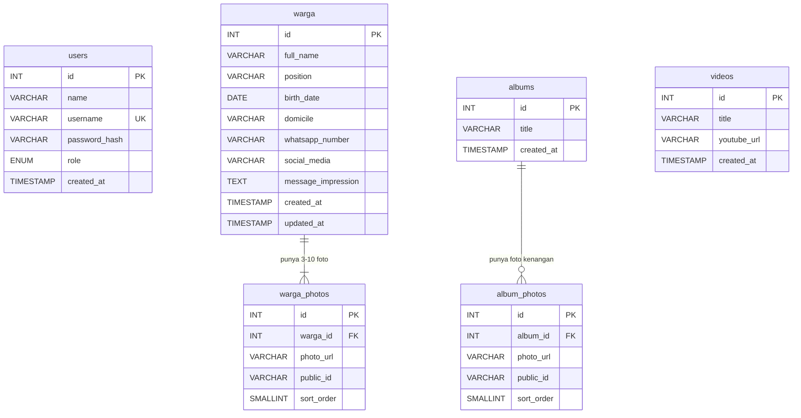

# Database Design — Warga Halim

Sumber kebenaran: [`PRD.md`](./PRD.md) bagian "Database". Dokumen ini menambahkan constraint, relasi, dan aturan agar mudah diimplementasikan.

---

## 1. Ringkasan

- **DBMS:** MySQL, engine InnoDB, charset `utf8mb4`.
- **Driver:** `mysql2` (pakai versi promise + connection pool).
- **Jumlah tabel:** 6 → `users`, `warga`, `warga_photos`, `albums`, `album_photos`, `videos`.
- **Query wajib pakai placeholder `?`.** Jangan pernah menyambung string SQL dengan input user.
  ```ts
  // BENAR
  db.query("SELECT * FROM warga WHERE id = ?", [id]);
  // SALAH
  db.query("SELECT * FROM warga WHERE id = " + id);
  ```
- **Yang TIDAK disimpan di database:**
  - File foto → disimpan di Cloudinary. Database hanya menyimpan `photo_url` dan `public_id`.
  - File video → tidak diunggah. Database hanya menyimpan link YouTube.
  - Profil perusahaan → teks statis di `client/src/content/profilPerusahaan.ts`.

---

## 2. Diagram Relasi



Penting untuk dipahami:

1. **`users` dan `warga` adalah dua hal berbeda.** `users` = akun login. `warga` = biodata mantan karyawan yang diisi admin. Tidak ada relasi antara keduanya (user yang mendaftar tidak otomatis punya biodata).
2. **Album bersifat umum, bukan per karyawan.** `albums` dan `album_photos` **tidak** punya kolom `warga_id` dan tidak berhubungan dengan `warga`. Jangan menambahkan relasi ini.
3. **Foto biodata ≠ foto album.** Foto biodata ada di `warga_photos` (milik satu warga). Foto album ada di `album_photos` (milik album umum).
4. **`videos` berdiri sendiri dan hanya berisi 0 atau 1 baris.** Satu-satunya video itu yang tampil di beranda.
5. **Menghapus akun user tidak mempengaruhi tabel lain**, karena `users` tidak berelasi dengan tabel mana pun.

---

## 3. Detail Tabel

### 3.1 `users` — akun login

| Kolom | Tipe | Constraint | Keterangan |
| --- | --- | --- | --- |
| `id` | INT | PK, AUTO_INCREMENT | |
| `name` | VARCHAR(100) | NOT NULL | Nama akun |
| `username` | VARCHAR(100) | NOT NULL, UNIQUE | Username akun (min 3 karakter) untuk login |
| `password_hash` | VARCHAR(255) | NOT NULL | Hasil bcrypt (cost ≥ 10). Jangan pernah dikirim ke frontend |
| `role` | ENUM('admin','user') | NOT NULL, DEFAULT 'user' | Register selalu `user`. Admin hanya dari seed |
| `created_at` | TIMESTAMP | NOT NULL, DEFAULT CURRENT_TIMESTAMP | |

### 3.2 `warga` — biodata mantan karyawan (diisi admin)

| Kolom | Tipe | Constraint | Keterangan |
| --- | --- | --- | --- |
| `id` | INT | PK, AUTO_INCREMENT | |
| `full_name` | VARCHAR(150) | NOT NULL | Wajib. Dipakai untuk pencarian |
| `position` | VARCHAR(100) | NOT NULL | Posisi terakhir. **Wajib** |
| `birth_date` | DATE | NOT NULL | Tanggal lahir. **Wajib** (format YYYY-MM-DD) |
| `domicile` | VARCHAR(150) | NOT NULL | Domisili tempat tinggal saat ini. **Wajib** |
| `whatsapp_number` | VARCHAR(100) | NULL | Nomor WhatsApp warga. Opsional |
| `social_media` | VARCHAR(255) | NULL | Akun atau tautan media sosial. Opsional |
| `message_impression` | TEXT | NULL | Pesan & kesan. Maks 1000 karakter (dicek Zod). **Hanya ditulis lewat endpoint admin** |
| `created_at` | TIMESTAMP | NOT NULL, DEFAULT CURRENT_TIMESTAMP | |
| `updated_at` | TIMESTAMP | NOT NULL, DEFAULT CURRENT_TIMESTAMP ON UPDATE CURRENT_TIMESTAMP | |

Kolom `position`, `birth_date`, dan `domicile` wajib diisi. Kolom `whatsapp_number` (sebelumnya `contact`) dan `social_media` bersifat opsional. Tidak ada kolom divisi, tahun masuk, atau tahun keluar.

### 3.3 `warga_photos` — foto biodata (3–10 per warga)

| Kolom | Tipe | Constraint | Keterangan |
| --- | --- | --- | --- |
| `id` | INT | PK, AUTO_INCREMENT | |
| `warga_id` | INT | NOT NULL, FK → `warga.id` ON DELETE CASCADE | |
| `photo_url` | VARCHAR(255) | NOT NULL | URL Cloudinary |
| `public_id` | VARCHAR(255) | NOT NULL | Untuk menghapus file di Cloudinary |
| `sort_order` | SMALLINT | NOT NULL | 1, 2, 3, … **Urutan 1 = foto kartu** |

### 3.4 `albums` — album kenangan umum

| Kolom | Tipe | Constraint | Keterangan |
| --- | --- | --- | --- |
| `id` | INT | PK, AUTO_INCREMENT | |
| `title` | VARCHAR(100) | NOT NULL | Tampil di bawah foto slideshow dan di galeri |
| `created_at` | TIMESTAMP | NOT NULL, DEFAULT CURRENT_TIMESTAMP | |

### 3.5 `album_photos` — foto di dalam album

| Kolom | Tipe | Constraint | Keterangan |
| --- | --- | --- | --- |
| `id` | INT | PK, AUTO_INCREMENT | |
| `album_id` | INT | NOT NULL, FK → `albums.id` ON DELETE CASCADE | |
| `photo_url` | VARCHAR(255) | NOT NULL | URL Cloudinary |
| `public_id` | VARCHAR(255) | NOT NULL | Untuk menghapus file di Cloudinary |
| `sort_order` | SMALLINT | NOT NULL | Urutan dalam album |

### 3.6 `videos` — satu link YouTube

Tabel ini **paling banyak berisi 1 baris**. Saat admin menyimpan video baru, service menghapus semua baris lama lalu memasukkan baris baru (dalam satu transaksi).

| Kolom | Tipe | Constraint | Keterangan |
| --- | --- | --- | --- |
| `id` | INT | PK, AUTO_INCREMENT | |
| `title` | VARCHAR(100) | NOT NULL | Judul video, diisi admin |
| `youtube_url` | VARCHAR(255) | NOT NULL | Hanya domain youtube.com / youtu.be (dicek Zod) |
| `created_at` | TIMESTAMP | NOT NULL, DEFAULT CURRENT_TIMESTAMP | Waktu video dipasang |

---

## 4. `server/sql/schema.sql`

```sql
CREATE TABLE IF NOT EXISTS users (
  id INT AUTO_INCREMENT PRIMARY KEY,
  name VARCHAR(100) NOT NULL,
  username VARCHAR(100) NOT NULL UNIQUE,
  password_hash VARCHAR(255) NOT NULL,
  role ENUM('admin','user') NOT NULL DEFAULT 'user',
  created_at TIMESTAMP NOT NULL DEFAULT CURRENT_TIMESTAMP
) ENGINE=InnoDB DEFAULT CHARSET=utf8mb4 COLLATE=utf8mb4_unicode_ci;

CREATE TABLE IF NOT EXISTS warga (
  id INT AUTO_INCREMENT PRIMARY KEY,
  full_name VARCHAR(150) NOT NULL,
  position VARCHAR(100) NOT NULL,
  contact VARCHAR(150) NULL,
  message_impression TEXT NULL,
  created_at TIMESTAMP NOT NULL DEFAULT CURRENT_TIMESTAMP,
  updated_at TIMESTAMP NOT NULL DEFAULT CURRENT_TIMESTAMP ON UPDATE CURRENT_TIMESTAMP,
  INDEX idx_warga_full_name (full_name)
) ENGINE=InnoDB DEFAULT CHARSET=utf8mb4 COLLATE=utf8mb4_unicode_ci;

CREATE TABLE IF NOT EXISTS warga_photos (
  id INT AUTO_INCREMENT PRIMARY KEY,
  warga_id INT NOT NULL,
  photo_url VARCHAR(255) NOT NULL,
  public_id VARCHAR(255) NOT NULL,
  sort_order SMALLINT NOT NULL,
  INDEX idx_warga_photos_order (warga_id, sort_order),
  CONSTRAINT fk_warga_photos_warga FOREIGN KEY (warga_id)
    REFERENCES warga(id) ON DELETE CASCADE
) ENGINE=InnoDB DEFAULT CHARSET=utf8mb4 COLLATE=utf8mb4_unicode_ci;

-- Album umum: TIDAK ada warga_id
CREATE TABLE IF NOT EXISTS albums (
  id INT AUTO_INCREMENT PRIMARY KEY,
  title VARCHAR(100) NOT NULL,
  created_at TIMESTAMP NOT NULL DEFAULT CURRENT_TIMESTAMP
) ENGINE=InnoDB DEFAULT CHARSET=utf8mb4 COLLATE=utf8mb4_unicode_ci;

CREATE TABLE IF NOT EXISTS album_photos (
  id INT AUTO_INCREMENT PRIMARY KEY,
  album_id INT NOT NULL,
  photo_url VARCHAR(255) NOT NULL,
  public_id VARCHAR(255) NOT NULL,
  sort_order SMALLINT NOT NULL,
  INDEX idx_album_photos_order (album_id, sort_order),
  CONSTRAINT fk_album_photos_album FOREIGN KEY (album_id)
    REFERENCES albums(id) ON DELETE CASCADE
) ENGINE=InnoDB DEFAULT CHARSET=utf8mb4 COLLATE=utf8mb4_unicode_ci;

CREATE TABLE IF NOT EXISTS videos (
  id INT AUTO_INCREMENT PRIMARY KEY,
  title VARCHAR(100) NOT NULL,
  youtube_url VARCHAR(255) NOT NULL,
  created_at TIMESTAMP NOT NULL DEFAULT CURRENT_TIMESTAMP
) ENGINE=InnoDB DEFAULT CHARSET=utf8mb4 COLLATE=utf8mb4_unicode_ci;
```

> Index `idx_warga_full_name` dan index `(…_id, sort_order)` hanya untuk mempercepat query; bukan fitur baru.

---

## 5. Aturan yang Dijaga di Kode (bukan oleh SQL)

| # | Aturan | Di mana dicek |
| --- | --- | --- |
| 1 | Setiap warga punya **3–10 foto**. Ditolak (400) jika kurang/lebih, saat tambah maupun ubah | Zod (form + backend) dan service sebelum simpan |
| 2 | `sort_order` warga_photos selalu berurutan 1..N tanpa lompat. Setelah hapus/urutkan ulang, nomori ulang | Service warga |
| 3 | Daftar warga (`GET /api/warga`) hanya mengambil foto `sort_order = 1` per warga | Query service |
| 4 | `message_impression` maks 1000 karakter dan **hanya ditulis oleh endpoint admin** | Zod + route admin |
| 5 | Simpan `warga` + `warga_photos` dalam **satu transaksi** (`beginTransaction` → `commit` / `rollback`) | Service warga |
| 6 | Saat hapus warga/album: ambil dulu semua `public_id`, hapus baris, lalu hapus file di Cloudinary. `ON DELETE CASCADE` hanya menghapus baris MySQL, **bukan** file Cloudinary | Service warga & album |
| 7 | Jika upload ke Cloudinary sudah berhasil tetapi simpan ke DB gagal → hapus file yang sudah terunggah | Service |
| 8 | Saat ubah warga, foto lama yang dibuang juga dihapus dari Cloudinary | Service warga |
| 9 | Register selalu membuat `role = 'user'`. Field `role` dari request diabaikan | Service auth |
| 10 | Akun admin dibuat oleh `npm run seed:admin` dari `ADMIN_USERNAME` (atau `ADMIN_EMAIL`) + `ADMIN_PASSWORD` di `.env`. Jika username sudah ada, jangan buat duplikat | `scripts/seed-admin.ts` |
| 11 | `youtube_url` hanya domain youtube.com / youtu.be | Zod |
| 12 | Tabel `videos` maksimal 1 baris: simpan video = `DELETE FROM videos` lalu `INSERT` dalam satu transaksi | Service video |
| 13 | `position` wajib (tidak boleh kosong/spasi saja) | Zod + `NOT NULL` |
| 14 | Register: `name` minimal 6 karakter, `username` minimal 3 karakter dan dilarang berupa format email (pesan: "Username tidak valid"), `password` minimal 8 karakter (sebelum di-hash); form frontend juga memvalidasi `confirmPassword` cocok | Zod (form + backend) |
| 15 | Hapus akun: hanya baris dengan `role = 'user'` yang boleh dihapus (`DELETE FROM users WHERE id = ? AND role = 'user'`). Akun admin tidak bisa dihapus | Service akun |
| 16 | Middleware auth memeriksa user dari token masih ada di `users`. Jika sudah dihapus → 401 | Middleware auth |
| 17 | Foto (warga & album) hanya disimpan lewat endpoint admin | Route admin |
| 18 | Album memuat **1–50 foto**. Admin dapat membuat album baru, mengubah album (`PUT /api/admin/albums/:id`), dan menambahkan foto ke album yang ada (`POST /api/admin/albums/:id/photos`). Urutan `sort_order` dinomori ulang berurutan. Ditolak jika total foto kurang dari 1 atau melebihi 50 foto | Multer, Zod, & service album |

### Contoh query daftar warga (foto kartu saja)

```sql
SELECT w.id, w.full_name, w.position, p.photo_url AS card_photo_url
FROM warga w
LEFT JOIN warga_photos p ON p.warga_id = w.id AND p.sort_order = 1
WHERE w.full_name LIKE ?
ORDER BY w.full_name ASC;
-- parameter: [`%${search}%`]  (jika search kosong, pakai '%%')
```

---

## 6. Status Keputusan

Sudah diputuskan (15–16 Nov 2026): Kolom `city` diganti menjadi `position` (posisi terakhir, wajib `NOT NULL`), kolom `email` pada tabel `users` diganti menjadi `username VARCHAR(100) NOT NULL UNIQUE` (minimal 3 karakter, dilarang berupa bentuk email dengan pesan "Username tidak valid", placeholder contoh "Contoh: budi_santoso"), antarmuka dikembalikan ke **bahasa Indonesia**, tema warna brand utama menggunakan **#005A9C** dan **white**, video beranda tunggal (YouTube embed), album umum tanpa `warga_id`, akun user bisa dihapus admin, batas foto per album ditingkatkan menjadi **1–50 foto**, fitur edit album (`PUT /api/admin/albums/:id`), penambahan foto ke album yang sudah ada (`POST /api/admin/albums/:id/photos`) dengan tombol "+ Tambah Foto" dan form terpisah dari "Ubah Album" pada antarmuka admin, fitur perbesar foto galeri (*lightbox modal*), batas 3–10 foto per warga, serta scroll restoration ke posisi paling atas saat perpindahan rute.
